# L3-visual — 2D 投影 + 人工 cluster boundary 检查 (data_v3, 2026-05-24)

- 4 个 source space × 3 投影 (pca, tsne, umap)
- 颜色 = 该 source 上 K-means K=4 cluster 分配
- 目的: 视觉确认 cluster boundary 是否清晰 (silhouette 数字看不出形状)

## Source: `4d_EFA_factor` (shape (163, 4))

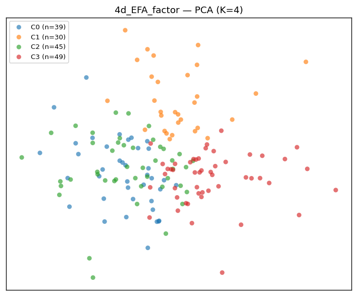
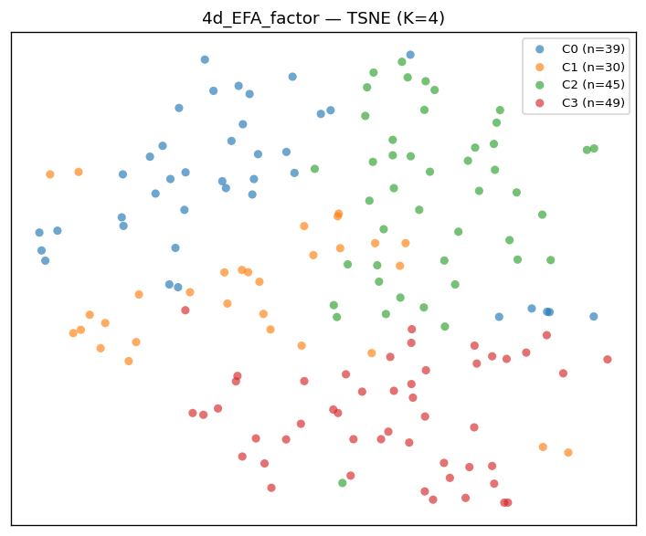
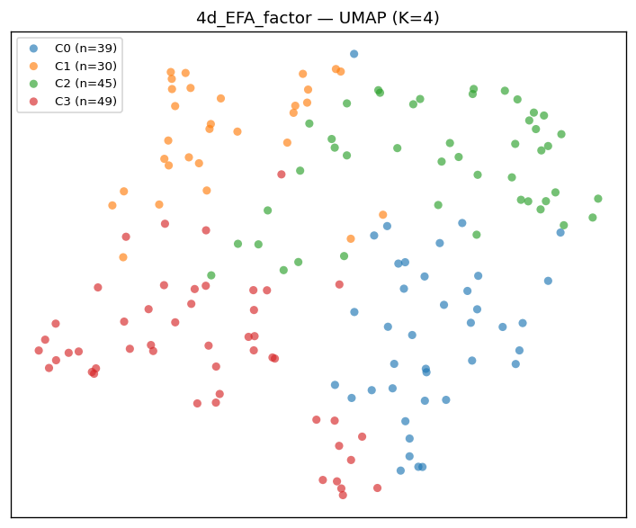

## Source: `30d_trait` (shape (163, 30))

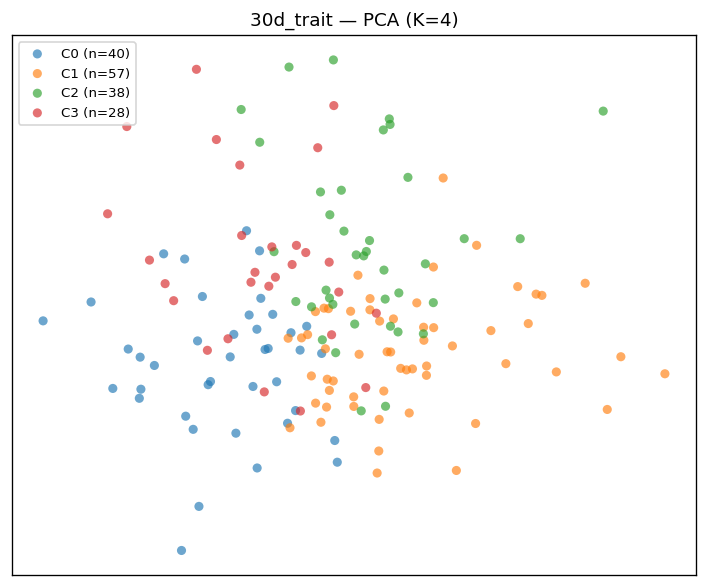
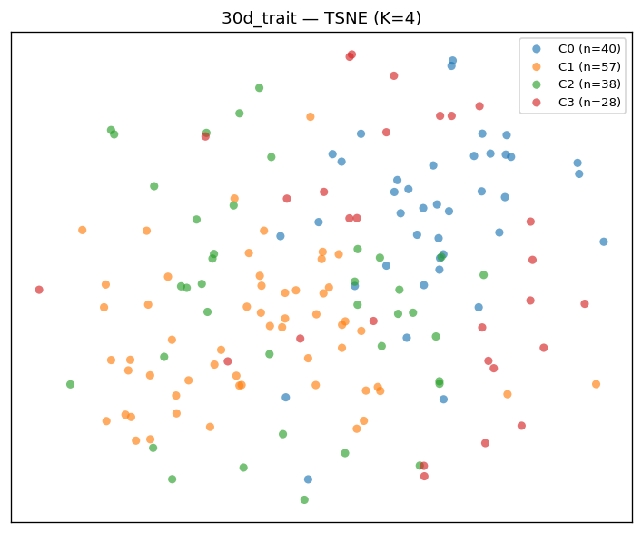
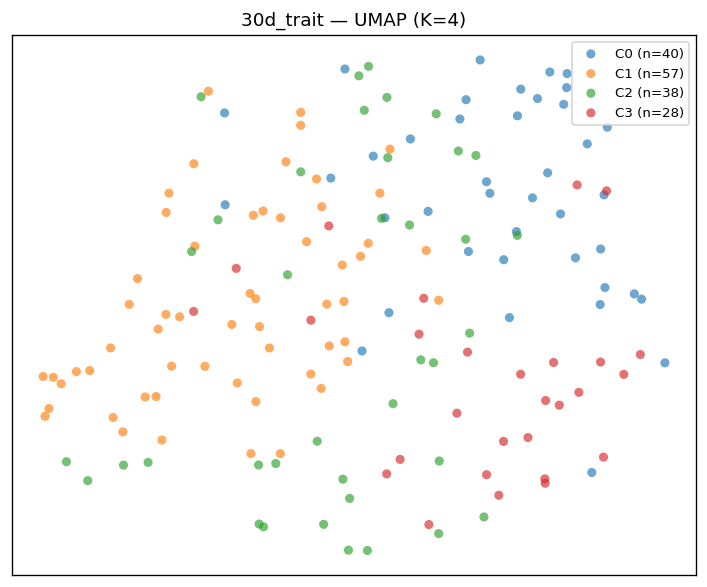

## Source: `Q_option_behavior` (shape (163, 23))

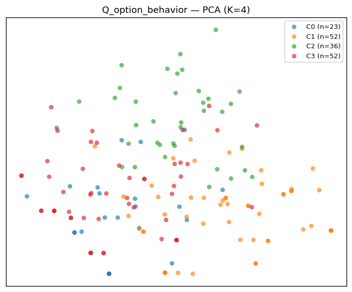
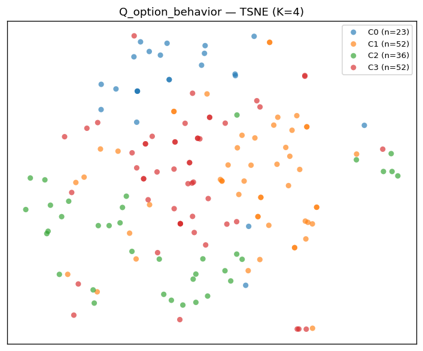
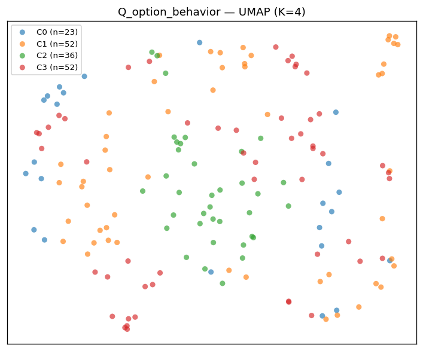

## Source: `joint_trait_plus_behavior` (shape (163, 53))

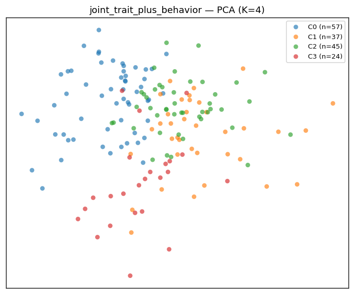
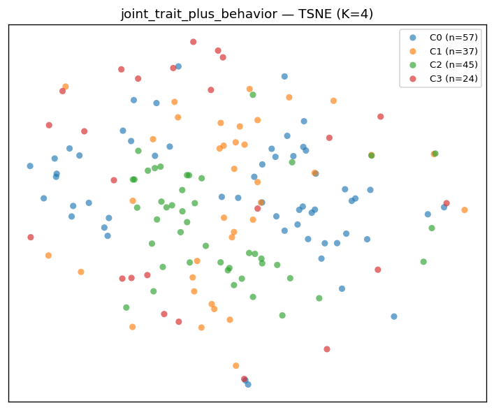
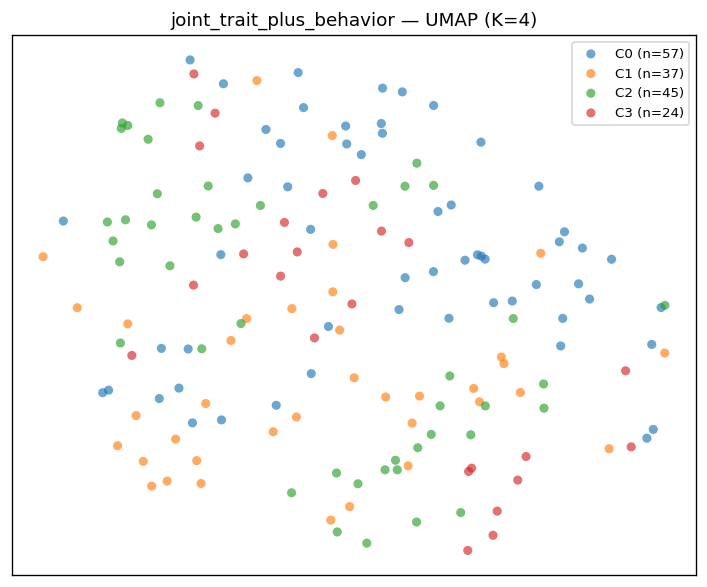

---

## 人工 cluster boundary 判断 (Claude, 2026-05-24)

| Source | t-SNE | UMAP | PCA | 综合判断 |
|---|---|---|---|---|
| 4d_EFA_factor | ?  (有大致空间区域但边界渐变) | ?  | ?  (PCA 由 EFA 已是线性, 类似) | **soft partition of continuous manifold** — K-means 强行切, 不是真 archetype |
| 30d_trait | ×  (颜色全混) | ×  | ×  | **无 cluster structure** — 跟数字 sil=0.05 一致 |
| Q_option_behavior | ?  (部分局部集中, 中间重叠多) | ?  | ?  | **sparse fingerprint** — 不是 clean cluster, 是 10+ 个 sub-pattern |
| joint_trait+behavior | ×  (trait 噪声主导) | ×  | ×  | **muddy** — 不要做 joint |

判断指南:
- **✓ (clean cluster)**: 点明显分团, 团之间有空白, 团内紧
- **? (有 structure 但糊)**: 看出来有中心, 但 boundary 模糊
- **× (无 structure)**: 散开一团, 颜色随机分布

## Verdict

- **4-d EFA** 看起来有 cluster, 但其实是 "EFA 降维平滑后 + K-means 任意切割连续 manifold"; 30-d 一展开就露馅 (颜色全混)
- **没有任何 source 显示 clean cluster boundary**
- → 视觉证据 (4 source × 3 method = 12 张图) 实证支持 **'trait-continuous + behavior-fingerprint'** framing
- → brief v3.5.1 §3.5 '4 层 cluster conditioning' 应重写