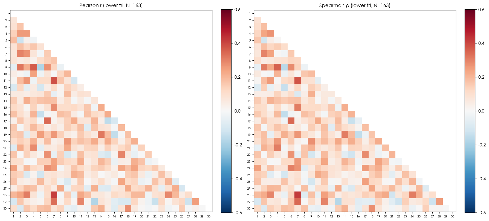
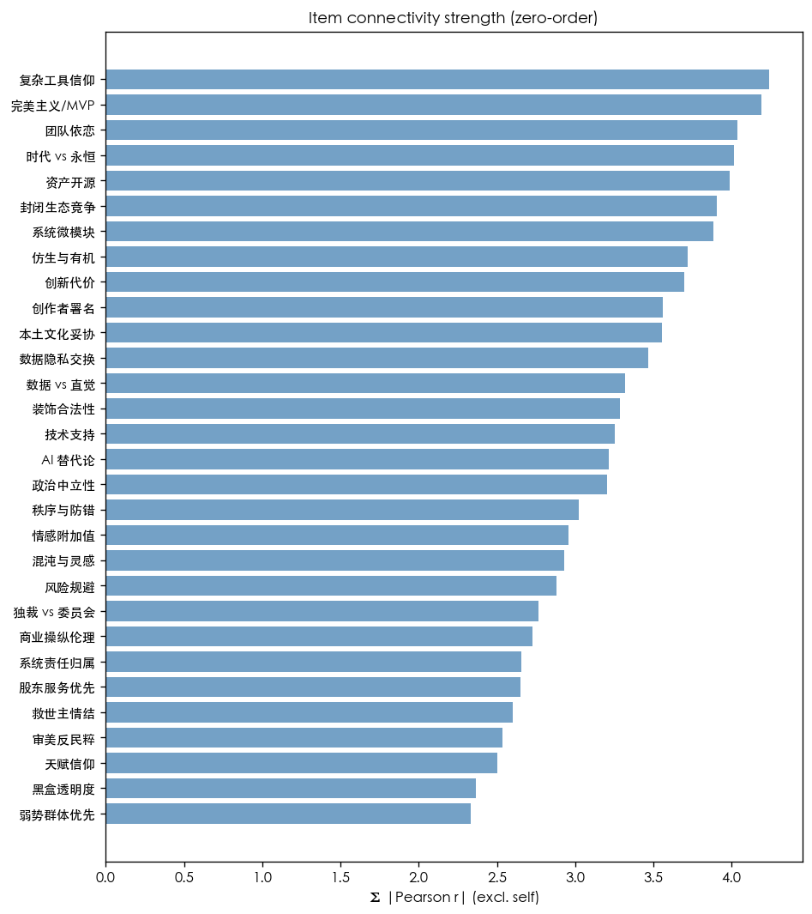

# L6 — 30×30 Inter-Item Correlation (data_v3, 2026-05-24)

E1 of 30-dim relationship analysis. Zero-order (Pearson + Spearman).
互补: L2 EFA (latent), L9 network (partial correlation / conditional).

- N = 163, items = 30
- Pearson r off-diag: median = 0.088, mean |r| = 0.112, max |r| = 0.413
- Spearman ρ off-diag: median = 0.090, mean |ρ| = 0.111
- corr matrix det = 1.71e-03  (PASS (non-singular))
- BH-FDR α=.05 threshold: Pearson p ≤ 0.0054, Spearman p ≤ 0.0047
- significant pairs (BH-FDR .05): Pearson 48/435, Spearman 43/435

## Item index legend

|   idx | item      |
|------:|:----------|
|     1 | AI 替代论    |
|     2 | 仿生与有机     |
|     3 | 创作者署名     |
|     4 | 创新代价      |
|     5 | 商业操纵伦理    |
|     6 | 团队依恋      |
|     7 | 复杂工具信仰    |
|     8 | 天赋信仰      |
|     9 | 完美主义/MVP  |
|    10 | 审美反民粹     |
|    11 | 封闭生态竞争    |
|    12 | 弱势群体优先    |
|    13 | 情感附加值     |
|    14 | 技术支持      |
|    15 | 政治中立性     |
|    16 | 救世主情结     |
|    17 | 数据 vs 直觉  |
|    18 | 数据隐私交换    |
|    19 | 时代 vs 永恒  |
|    20 | 本土文化妥协    |
|    21 | 混沌与灵感     |
|    22 | 独裁 vs 委员会 |
|    23 | 秩序与防错     |
|    24 | 系统微模块     |
|    25 | 系统责任归属    |
|    26 | 股东服务优先    |
|    27 | 装饰合法性     |
|    28 | 资产开源      |
|    29 | 风险规避      |
|    30 | 黑盒透明度     |

## Heatmap (Pearson + Spearman lower-tri)

## High-correlation pairs (|r| ≥ 0.5, sorted by |Pearson r|)

_无 pair 跨过 |r| ≥ 0.5._ (见下方 top-20 fallback)

## Top-20 pairs by |Pearson r| 

|   i |   j | item_i   | item_j    |   pearson_r |   pearson_p |   spearman_r | sign_agree   |
|----:|----:|:---------|:----------|------------:|------------:|-------------:|:-------------|
|   7 |  28 | 复杂工具信仰   | 资产开源      |       0.413 |      0      |        0.418 | True         |
|   7 |  11 | 复杂工具信仰   | 封闭生态竞争    |       0.383 |      0      |        0.377 | True         |
|   4 |   9 | 创新代价     | 完美主义/MVP  |       0.367 |      0      |        0.358 | True         |
|   6 |  17 | 团队依恋     | 数据 vs 直觉  |       0.34  |      0      |        0.345 | True         |
|   7 |  29 | 复杂工具信仰   | 风险规避      |       0.336 |      0      |        0.343 | True         |
|   2 |   9 | 仿生与有机    | 完美主义/MVP  |       0.32  |      0      |        0.312 | True         |
|  14 |  19 | 技术支持     | 时代 vs 永恒  |       0.314 |      0      |        0.305 | True         |
|   3 |  28 | 创作者署名    | 资产开源      |       0.309 |      0.0001 |        0.293 | True         |
|   2 |   7 | 仿生与有机    | 复杂工具信仰    |       0.3   |      0.0001 |        0.296 | True         |
|  17 |  22 | 数据 vs 直觉 | 独裁 vs 委员会 |       0.294 |      0.0001 |        0.281 | True         |
|  11 |  29 | 封闭生态竞争   | 风险规避      |       0.293 |      0.0001 |        0.298 | True         |
|  24 |  28 | 系统微模块    | 资产开源      |       0.289 |      0.0002 |        0.307 | True         |
|   7 |  15 | 复杂工具信仰   | 政治中立性     |       0.284 |      0.0002 |        0.308 | True         |
|   4 |  21 | 创新代价     | 混沌与灵感     |       0.282 |      0.0003 |        0.309 | True         |
|  18 |  30 | 数据隐私交换   | 黑盒透明度     |       0.279 |      0.0003 |        0.277 | True         |
|   6 |   9 | 团队依恋     | 完美主义/MVP  |       0.276 |      0.0004 |        0.286 | True         |
|   6 |  22 | 团队依恋     | 独裁 vs 委员会 |       0.275 |      0.0004 |        0.268 | True         |
|   6 |  24 | 团队依恋     | 系统微模块     |       0.274 |      0.0004 |        0.304 | True         |
|   3 |   7 | 创作者署名    | 复杂工具信仰    |       0.269 |      0.0005 |        0.242 | True         |
|   3 |  11 | 创作者署名    | 封闭生态竞争    |       0.267 |      0.0006 |        0.257 | True         |

## Item connectivity strength (Σ |Pearson r|, exclude self)

| item      |   strength_sum_abs_r |
|:----------|---------------------:|
| 复杂工具信仰    |                4.24  |
| 完美主义/MVP  |                4.193 |
| 团队依恋      |                4.036 |
| 时代 vs 永恒  |                4.013 |
| 资产开源      |                3.988 |
| 封闭生态竞争    |                3.904 |
| 系统微模块     |                3.881 |
| 仿生与有机     |                3.717 |
| 创新代价      |                3.698 |
| 创作者署名     |                3.56  |
| 本土文化妥协    |                3.555 |
| 数据隐私交换    |                3.465 |
| 数据 vs 直觉  |                3.318 |
| 装饰合法性     |                3.285 |
| 技术支持      |                3.252 |
| AI 替代论    |                3.213 |
| 政治中立性     |                3.206 |
| 秩序与防错     |                3.022 |
| 情感附加值     |                2.959 |
| 混沌与灵感     |                2.932 |
| 风险规避      |                2.88  |
| 独裁 vs 委员会 |                2.763 |
| 商业操纵伦理    |                2.729 |
| 系统责任归属    |                2.658 |
| 股东服务优先    |                2.65  |
| 救世主情结     |                2.6   |
| 审美反民粹     |                2.534 |
| 天赋信仰      |                2.503 |
| 黑盒透明度     |                2.367 |
| 弱势群体优先    |                2.335 |

## Verdict

- 无 pair 跨过 |r|≥0.5 → zero-order 关联整体弱, 跟 L2 PA K=4 cumulative variance 23% 一致
- 最强 hub: **复杂工具信仰** (Σ|r|=4.24), 最弱: **弱势群体优先** (Σ|r|=2.335)
- 下游: L9 network 跑 partial correlation 看哪些 zero-order 关联是 spurious (third-variable)