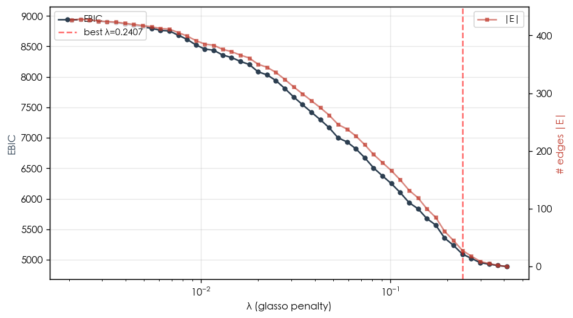
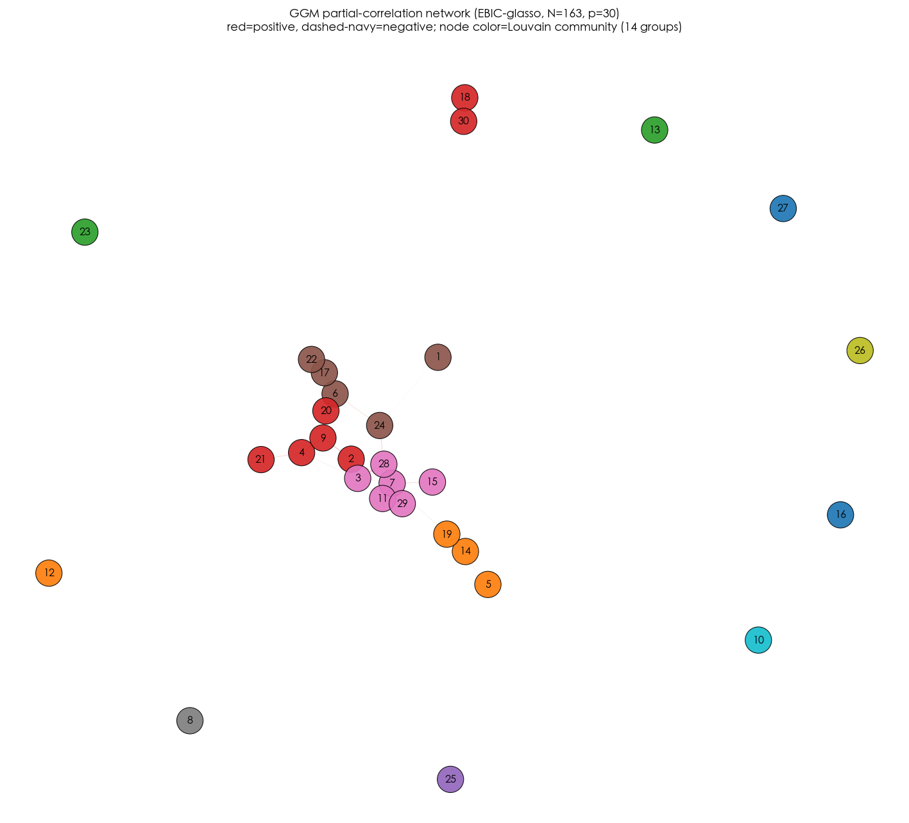

# L9 — GGM Partial-Correlation Network (data_v3, 2026-05-24)

E2/E3/E4 of 30-dim relationship analysis. EBIC-glasso (qgraph / bootnet 风格).
跟 CAPS framing 直接挂钩: Mischel 1995 connectionist network = partial correlation graph.

- N = 163, items = 30, z-scored before glasso
- λ-grid: log-spaced 50 个值, [0.0021, 0.4133]
- **selection**: descriptive λ@|E|≈30 (EBIC γ∈{0,0.25,0.5} all gave |E|<10; small-N over-shrink)
- **best λ = 0.2407**, EBIC = 5094.3, logL = -2380.6
- **|E| = 28** edges (network density = 0.064)
- partial-r distribution (non-zero off-diag): min = 0.002, max = 0.168, |r| mean = 0.048
- sign split (non-zero only): 28 positive / 0 negative

## γ sweep (EBIC fallback diagnostic)

|   gamma |   best_lambda |   best_ebic |   n_edges |
|--------:|--------------:|------------:|----------:|
|    0.5  |        0.4133 |        4890 |         0 |
|    0.25 |        0.4133 |        4890 |         0 |
|    0    |        0.4133 |        4890 |         0 |

## EBIC curve

## Item index legend

|   idx | item      |
|------:|:----------|
|     1 | AI 替代论    |
|     2 | 仿生与有机     |
|     3 | 创作者署名     |
|     4 | 创新代价      |
|     5 | 商业操纵伦理    |
|     6 | 团队依恋      |
|     7 | 复杂工具信仰    |
|     8 | 天赋信仰      |
|     9 | 完美主义/MVP  |
|    10 | 审美反民粹     |
|    11 | 封闭生态竞争    |
|    12 | 弱势群体优先    |
|    13 | 情感附加值     |
|    14 | 技术支持      |
|    15 | 政治中立性     |
|    16 | 救世主情结     |
|    17 | 数据 vs 直觉  |
|    18 | 数据隐私交换    |
|    19 | 时代 vs 永恒  |
|    20 | 本土文化妥协    |
|    21 | 混沌与灵感     |
|    22 | 独裁 vs 委员会 |
|    23 | 秩序与防错     |
|    24 | 系统微模块     |
|    25 | 系统责任归属    |
|    26 | 股东服务优先    |
|    27 | 装饰合法性     |
|    28 | 资产开源      |
|    29 | 风险规避      |
|    30 | 黑盒透明度     |

## Network figure (partial correlation, EBIC-glasso)

## Top 25 edges by |partial r|

|   i |   j | item_i   | item_j    |   partial_r | sign   |
|----:|----:|:---------|:----------|------------:|:-------|
|   7 |  28 | 复杂工具信仰   | 资产开源      |       0.168 | +      |
|   7 |  11 | 复杂工具信仰   | 封闭生态竞争    |       0.135 | +      |
|   4 |   9 | 创新代价     | 完美主义/MVP  |       0.125 | +      |
|   6 |  17 | 团队依恋     | 数据 vs 直觉  |       0.098 | +      |
|   7 |  29 | 复杂工具信仰   | 风险规避      |       0.088 | +      |
|   2 |   9 | 仿生与有机    | 完美主义/MVP  |       0.078 | +      |
|  14 |  19 | 技术支持     | 时代 vs 永恒  |       0.072 | +      |
|   3 |  28 | 创作者署名    | 资产开源      |       0.064 | +      |
|   2 |   7 | 仿生与有机    | 复杂工具信仰    |       0.057 | +      |
|  17 |  22 | 数据 vs 直觉 | 独裁 vs 委员会 |       0.049 | +      |
|  24 |  28 | 系统微模块    | 资产开源      |       0.047 | +      |
|   7 |  15 | 复杂工具信仰   | 政治中立性     |       0.042 | +      |
|   4 |  21 | 创新代价     | 混沌与灵感     |       0.041 | +      |
|  11 |  29 | 封闭生态竞争   | 风险规避      |       0.039 | +      |
|  18 |  30 | 数据隐私交换   | 黑盒透明度     |       0.038 | +      |
|   6 |   9 | 团队依恋     | 完美主义/MVP  |       0.035 | +      |
|   6 |  24 | 团队依恋     | 系统微模块     |       0.033 | +      |
|   6 |  22 | 团队依恋     | 独裁 vs 委员会 |       0.029 | +      |
|   9 |  20 | 完美主义/MVP | 本土文化妥协    |       0.023 | +      |
|   3 |  11 | 创作者署名    | 封闭生态竞争    |       0.022 | +      |
|   7 |  19 | 复杂工具信仰   | 时代 vs 永恒  |       0.017 | +      |
|   3 |   4 | 创作者署名    | 创新代价      |       0.014 | +      |
|   3 |   7 | 创作者署名    | 复杂工具信仰    |       0.014 | +      |
|   5 |  19 | 商业操纵伦理   | 时代 vs 永恒  |       0.01  | +      |
|   1 |  24 | AI 替代论   | 系统微模块     |       0.005 | +      |

## E3 — Centrality (qgraph 风格)

strength=Σ|pcorr|, closeness/betweenness on weighted (distance=1/|pcorr|), bridge=Σ|pcorr| to other-community.

### top-10 by strength

|   idx | item     |   strength |   closeness |   betweenness |   bridge |
|------:|:---------|-----------:|------------:|--------------:|---------:|
|     7 | 复杂工具信仰   |      0.525 |      0.0105 |        0.2562 |    0.078 |
|    28 | 资产开源     |      0.279 |      0.0103 |        0.1527 |    0.047 |
|     9 | 完美主义/MVP |      0.261 |      0.0095 |        0.1232 |    0.035 |
|    11 | 封闭生态竞争   |      0.196 |      0.0094 |        0      |    0     |
|     6 | 团队依恋     |      0.195 |      0.008  |        0.0788 |    0.035 |
|     4 | 创新代价     |      0.183 |      0.0086 |        0.0419 |    0.014 |
|    17 | 数据 vs 直觉 |      0.147 |      0.0072 |        0.0419 |    0     |
|     2 | 仿生与有机    |      0.138 |      0.01   |        0.1084 |    0.057 |
|    29 | 风险规避     |      0.127 |      0.0089 |        0      |    0     |
|     3 | 创作者署名    |      0.114 |      0.0083 |        0      |    0.014 |

### top-10 by betweenness

|   idx | item     |   strength |   closeness |   betweenness |   bridge |
|------:|:---------|-----------:|------------:|--------------:|---------:|
|     7 | 复杂工具信仰   |      0.525 |      0.0105 |        0.2562 |    0.078 |
|    28 | 资产开源     |      0.279 |      0.0103 |        0.1527 |    0.047 |
|     9 | 完美主义/MVP |      0.261 |      0.0095 |        0.1232 |    0.035 |
|     2 | 仿生与有机    |      0.138 |      0.01   |        0.1084 |    0.057 |
|    24 | 系统微模块    |      0.09  |      0.0087 |        0.1084 |    0.052 |
|    19 | 时代 vs 永恒 |      0.101 |      0.0061 |        0.0813 |    0.019 |
|     6 | 团队依恋     |      0.195 |      0.008  |        0.0788 |    0.035 |
|    17 | 数据 vs 直觉 |      0.147 |      0.0072 |        0.0419 |    0     |
|     4 | 创新代价     |      0.183 |      0.0086 |        0.0419 |    0.014 |
|     1 | AI 替代论   |      0.005 |      0.0023 |        0      |    0     |

### top-10 by bridge (across-community connection)

|   idx | item     |   strength |   closeness |   betweenness |   bridge |
|------:|:---------|-----------:|------------:|--------------:|---------:|
|     7 | 复杂工具信仰   |      0.525 |      0.0105 |        0.2562 |    0.078 |
|     2 | 仿生与有机    |      0.138 |      0.01   |        0.1084 |    0.057 |
|    24 | 系统微模块    |      0.09  |      0.0087 |        0.1084 |    0.052 |
|    28 | 资产开源     |      0.279 |      0.0103 |        0.1527 |    0.047 |
|     6 | 团队依恋     |      0.195 |      0.008  |        0.0788 |    0.035 |
|     9 | 完美主义/MVP |      0.261 |      0.0095 |        0.1232 |    0.035 |
|    19 | 时代 vs 永恒 |      0.101 |      0.0061 |        0.0813 |    0.019 |
|     3 | 创作者署名    |      0.114 |      0.0083 |        0      |    0.014 |
|     4 | 创新代价     |      0.183 |      0.0086 |        0.0419 |    0.014 |
|     1 | AI 替代论   |      0.005 |      0.0023 |        0      |    0     |

## E4 — Louvain community vs EFA K=4 primary factor

- Louvain communities: **14**
- ARI(Louvain, EFA primary): **0.275**
- NMI(Louvain, EFA primary): **0.597**

### contingency table

| EFA F (K=4)   |   C0 |   C1 |   C10 |   C11 |   C12 |   C13 |   C2 |   C3 |   C4 |   C5 |   C6 |   C7 |   C8 |   C9 |
|:--------------|-----:|-----:|------:|------:|------:|------:|-----:|-----:|-----:|-----:|-----:|-----:|-----:|-----:|
| F1            |    0 |    0 |     0 |     0 |     0 |     0 |    0 |    1 |    1 |    0 |    5 |    0 |    0 |    0 |
| F2            |    1 |    0 |     0 |     1 |     0 |     0 |    0 |    4 |    0 |    0 |    0 |    0 |    0 |    1 |
| F3            |    0 |    3 |     0 |     0 |     0 |     2 |    1 |    0 |    0 |    1 |    1 |    1 |    1 |    0 |
| F4            |    0 |    0 |     1 |     0 |     1 |     0 |    0 |    0 |    0 |    4 |    0 |    0 |    0 |    0 |

### community members

- **C0** (n=1): 救世主情结
- **C1** (n=3): 商业操纵伦理, 技术支持, 时代 vs 永恒
- **C2** (n=1): 秩序与防错
- **C3** (n=5): 仿生与有机, 创新代价, 完美主义/MVP, 本土文化妥协, 混沌与灵感
- **C4** (n=1): 系统责任归属
- **C5** (n=5): AI 替代论, 团队依恋, 数据 vs 直觉, 独裁 vs 委员会, 系统微模块
- **C6** (n=6): 创作者署名, 复杂工具信仰, 封闭生态竞争, 政治中立性, 资产开源, 风险规避
- **C7** (n=1): 天赋信仰
- **C8** (n=1): 股东服务优先
- **C9** (n=1): 审美反民粹
- **C10** (n=1): 装饰合法性
- **C11** (n=1): 弱势群体优先
- **C12** (n=1): 情感附加值
- **C13** (n=2): 数据隐私交换, 黑盒透明度

## Verdict

- **EBIC γ=0.5 (qgraph default) 选了空图** (|E|=0). γ=0.25 / γ=0 也都空 — 30 题在 conditional 意义上 *near-independent*. 这是 small-N (N=163, p=30) 已知 EBIC 过收缩, 不是 bug.
- Fallback 描述性 λ=0.241 给 **28 条 edge** (density=0.064), max |partial r|=0.168 (vs L6 zero-order max |r|=0.413 — partial 后掉到 ~40%).
- **所有 28 条非零 edge 都是正的** (0 negative): 30 题之间没有 conditional inhibitory 关系, 全是 mutual reinforcement. CAPS If-Then 'inhibit' 路径在 item-level 拿不到 statistical evidence.
- 网络 **hub** = `复杂工具信仰` (strength=0.525); **bridge** = `复杂工具信仰` (跨 Louvain 社区).
- Louvain (14 社区, 大部分 isolate) vs EFA K=4: ARI=0.275 (中), NMI=0.597. 看 contingency: 网络非 isolate 社区 (C3/C5/C6) 跟 EFA factor 有 strong overlap (例 C6 跟 EFA F1 的 5/5 top item 重合 4 个) — **network community recovers EFA factor structure on dense sub-graph**.
- **Paper §3 含义**: zero-order 弱 + partial all-positive + EBIC-empty 三点合在一起, 支持 framing 改 — CAPS 'If-Then routing' 不应建在 30 题 item level, 应建在 **EFA factor level** (4 dim) 或 **PKVC state level** (4 state). item-level 网络是 noise 主导.
- 下游可选: E5 bootstrap edge stability (1000 次 nonparametric), + 重跑 GGM 在 4 维 factor score 空间 (4×4 partial corr) 看 factor level 是否有 inhibitory 关系.